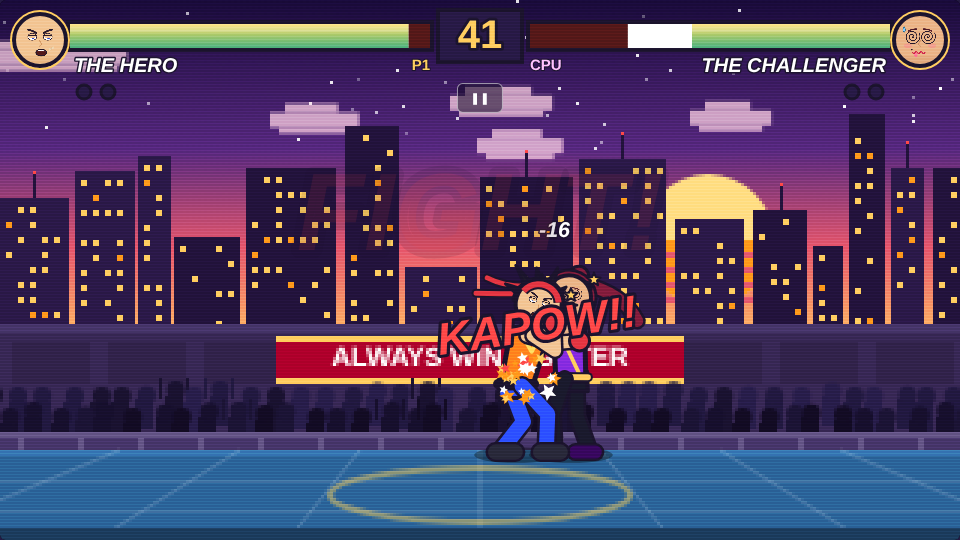

# Always Win Fighter

A browser-based 2D arcade fighting game, Street Fighter style, drawn entirely with the
HTML5 Canvas. Two fighters, one arena, best of three rounds. There is just one catch:
**the Hero always wins.** No matter what.



Plain HTML, CSS and JavaScript. No build step, no frameworks, no downloaded assets: every
sprite is drawn in code and every sound is synthesised with the Web Audio API.

## How to play

1. Open the game (see "Run it" below) and press **Start** (or Enter).
2. Watch the VS screen, then **ROUND 1... FIGHT!**
3. Punch the Challenger until she falls over, or do nothing and watch her fall over anyway.
4. Win two rounds to take the match, then hit **Play Again**.

### Controls

| Action | Keyboard | Touch |
| --- | --- | --- |
| Move | Arrow keys or `A` / `D` | ◀ ▶ |
| Jump | `↑` or `W` | ▲ JUMP |
| Block | `↓` or `S` (hold) | ▼ BLOCK (hold) |
| Jab (fast) | `J` | JAB |
| Power punch (short wind-up, big knockback) | `K` | POW |
| Pause | `P` or `Esc` | ❚❚ button under the timer |
| Start / confirm / play again | `Enter` or `Space` | tap |

On-screen touch buttons appear automatically on phones and tablets. They can be forced on or
off with the "Touch controls" button on the start screen. Rotate the phone sideways for a
bigger arena.

### The fighters

- **The Hero** (player 1): spiky hair, red headband, a plaster on his cheek. Record 999 - 0.
- **The Challenger** (computer): trained for years, trips a lot. Record 0 - 999.

### How the fight is rigged

- The Challenger's attacks do 1 or 2 damage. The Hero's health **can never drop below 10%**.
  When she hits him at 10% the game shows **PLOT ARMOR!** and nothing happens.
- A jab does 7 damage, a power punch does 16, breaks her guard and often knocks her down.
- If you do nothing, every few seconds the Challenger **trips** (OOPS!), **gets tired**
  (TIRED!), **whiffs** a huge haymaker (WHIFF!) or **sneezes** (ACHOO!), and hurts herself.
  She knocks herself out before the 60 second timer runs out. If the timer does run out she
  collapses from exhaustion anyway.
- Every round ends with **HERO WINS!** and a victory animation. A match is first to two rounds,
  which always means 2 - 0.


## Run it

The game is static. Either open `index.html` directly in a browser, or serve the folder:

```bash
python3 -m http.server 8000
```

then visit `http://localhost:8000/`.

## Host it on GitHub Pages

### As its own repository

```bash
git init
git add .
git commit -m "Always Win Fighter"
gh repo create always-win-fighter --public --source=. --remote=origin --push
gh api -X POST "repos/{owner}/always-win-fighter/pages" -f "source[branch]=main" -f "source[path]=/"
```

The site appears a minute later at `https://<your-user>.github.io/always-win-fighter/`.
You can also enable it by hand: repository **Settings** → **Pages** → **Source: Deploy from a
branch** → branch `main`, folder `/ (root)`.

### As a folder inside another site

Copy the `always-win-fighter/` folder into the site and it works at
`https://<site>/always-win-fighter/`. All paths in the game are relative.

## Project structure

| File | What it is |
| --- | --- |
| `index.html` | The page: canvas, overlay screens (start, customize, pause, victory) and touch buttons |
| `style.css` | Layout of the 16:9 stage, arcade-style buttons, touch controls, phone layouts |
| `game.js` | The whole game: sound, input, faces, animation, fighters, AI, arena, HUD, game loop |
| `assets/favicon.svg` | Browser tab icon |
| `assets/screenshot.png` | The screenshot above |

## How it works (for the curious)

- **Game loop**: `requestAnimationFrame` at the display rate (normally 60 FPS) with a clamped
  delta time, a short "hit stop" freeze on impact and slow motion on the K.O.
- **Fighters** are small skeletons. A *pose* stores the hip height, body rotation, torso lean,
  arm angles and foot positions; knees are solved with two-bone inverse kinematics. Animation
  *clips* are either keyframe lists or small procedural functions (walk cycle, idle breathing,
  victory hops) and the game blends smoothly between them when the state changes.
- **Hit detection** is a circle at the punching fist (or kicking foot) during the attack's
  active frames against an axis-aligned hurtbox around the opponent. Fighters are invulnerable
  while lying on the floor.
- **Effects**: screen shake, white flash, star-shaped hit sparks, dust, sweat, confetti and
  comic-book pop-ups (POW!, KAPOW!!, OOPS!, ACHOO!).
- **Arena**: drawn once at one third resolution and scaled up with image smoothing off, which
  gives the pixel-art look. Clouds drift and the crowd bobs.
- **Audio**: punches, blocks, whooshes, the K.O. sting, the round fanfare and the slide-whistle
  trip are all oscillators and filtered noise from the Web Audio API, created after the first
  key press or tap (browsers require a user gesture).
- **Debugging**: the running game is exposed as `window.AWF` in the browser console, for example
  `AWF.hero.hp`, `AWF.challenger.state` or `AWF.debugSpeed = 4` to fast-forward.

Everything here is original work drawn in code; there are no copyrighted characters or assets.
